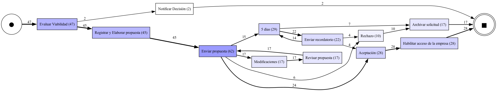

# Conclusión: comparación con el modelo BPMN (sección 4.4, punto 3)

Cómo ejecutar el análisis y qué decisiones de diseño se tomaron: ver [README.md](README.md).

## Datos analizados

Se analizaron **47 instancias**, todas terminadas, con 324 eventos de la etapa de negociación (la que ocurre antes de "Preparar curso"). Salen de una base generada con `make corridas` (semilla 10), así que son datos simulados:

- 40 corridas con destinos y modificaciones sorteados.
- 5 solicitudes aceptadas para llenar el cupo de cursos en ejecución.
- 2 solicitudes no viables.

Las 5 del cupo recorren todas la aceptación directa, por lo que inflan ese recorrido: sin ellas serían 14 de 42 casos (33,3 %) en lugar de 19 de 47 (40,4 %). El detalle está en el [README](README.md#los-datos-de-este-repositorio).

Se encontraron **13 recorridos distintos**. Se pueden visualizar en la salida de la terminal al ejecutar `analyze.py`

## Recorridos más frecuentes

Los tres más frecuentes (hay un empate en el tercer lugar, por eso son cuatro):

| # | Casos | % | Recorrido |
|---|---|---|---|
| 1 | 19 | 40,4 % | Evaluar Viabilidad → Registrar y Elaborar propuesta → Enviar propuesta → Aceptación → Habilitar acceso de la empresa |
| 2 | 7 | 14,9 % | Evaluar Viabilidad → Registrar y Elaborar propuesta → Enviar propuesta → 5 días → Enviar recordatorio → 5 días → Enviar recordatorio → 5 días → Archivar solicitud |
| 3 | 3 | 6,4 % | Evaluar Viabilidad → Registrar y Elaborar propuesta → Enviar propuesta → Modificaciones → Revisar propuesta → Enviar propuesta → Aceptación → Habilitar acceso de la empresa |
| 3 | 3 | 6,4 % | Evaluar Viabilidad → Registrar y Elaborar propuesta → Enviar propuesta → Modificaciones → Revisar propuesta → Enviar propuesta → Rechazo → Archivar solicitud |

Por destino final:

| Resultado | Casos |
|---|---|
| Aceptación (llega a Habilitar acceso) | 28 |
| Rechazo | 10 |
| Sin respuesta (archivada tras dos recordatorios) | 7 |
| No viable | 2 | 

## Comparación con la negociación del BPMN

### Coincidencias

- **Todos los recorridos observados son válidos en el BPMN.** Ninguna instancia hizo una secuencia que el modelo no permita.
- **Los caminos del BPMN aparecen en los datos:** solicitud no viable (`Notificar Decisión`), aceptación, rechazo, falta de respuesta, modificaciones (una y dos rondas) y recordatorios.
- **Los lazos se comportan como en el modelo.** Después de `Modificaciones` siempre viene `Revisar propuesta` y luego `Enviar propuesta`; después de `Enviar recordatorio`, el proceso vuelve a esperar respuesta.
- **Se respeta el límite de dos recordatorios.** Ningún recorrido tiene más de dos, y las 7 solicitudes sin respuesta se archivaron exactamente después del segundo.
- **Se cumplen las combinaciones de lazos.** Hay casos que mezclan modificaciones y recordatorios antes de aceptar o rechazar, como prevé el BPMN.

### Diferencias

- **Caminos permitidos que no aparecen.** Ninguna instancia recibió una solicitud de modificaciones después de un recordatorio: en el grafo no hay una flecha de `Enviar recordatorio` a `Modificaciones`. El BPMN lo permite, porque el proceso vuelve a la espera de respuesta. Por eso el modelo descubierto tampoco lo incluye: en ese punto es más restrictivo que el BPMN.
- **El modelo descubierto no impone el límite de dos recordatorios.** En `modelo_descubierto.png`, el lazo de `5 días` y `Enviar recordatorio` puede repetirse sin tope, y el recordatorio puede omitirse en cualquier vuelta, de modo que el modelo admite pasar de `5 días` directamente a `Aceptación` o `Rechazo` (en el BPMN, tras `5 días` solo se envía un recordatorio o se archiva la solicitud). Los datos nunca lo hacen, pero un algoritmo que solo ve el orden de las actividades no puede reconstruir un contador. En el BPMN, ese límite está en la decisión "¿2 recordatorios?".
- **Las decisiones y los eventos aparecen como elementos genéricos.** El modelo descubierto muestra compuertas exclusivas (X) en lugar de la compuerta basada en eventos "Esperar respuesta" y de las decisiones de viabilidad y de recordatorios, y dibuja "5 días", "Aceptación", "Rechazo" y "Modificaciones" como tareas comunes en lugar de eventos de tiempo y de mensaje: el log registra qué actividad ocurrió, no su tipo ni la condición de cada decisión.

### Limitaciones

- **Tamaño de la muestra.** Con 47 instancias, 9 de los 13 recorridos tienen 1 o 2 casos, y hay un empate en el tercer lugar.
- **Tiempos acortados.** El evento "5 días" se ejecutó con un plazo de 20 o 30 segundos, por lo que el log no sirve para analizar duraciones.

## Conclusión

Las ejecuciones de la negociación son coherentes con el modelo BPMN: todos los recorridos observados son válidos y los lazos de modificaciones y recordatorios, incluido el límite de dos recordatorios, se comportan como se diseñó. El recorrido más frecuente es la aceptación directa (19 de 47 casos), seguido de la falta de respuesta (7 casos). Las diferencias no son desvíos del proceso, sino del método: el modelo descubierto es más permisivo que el BPMN (no impone el límite de recordatorios) y no distingue el tipo de compuerta, y el camino de modificaciones después de un recordatorio no se observó por falta de casos, por lo que el modelo descubierto tampoco lo incluye. Como los datos son simulados, los resultados validan la estructura del proceso.